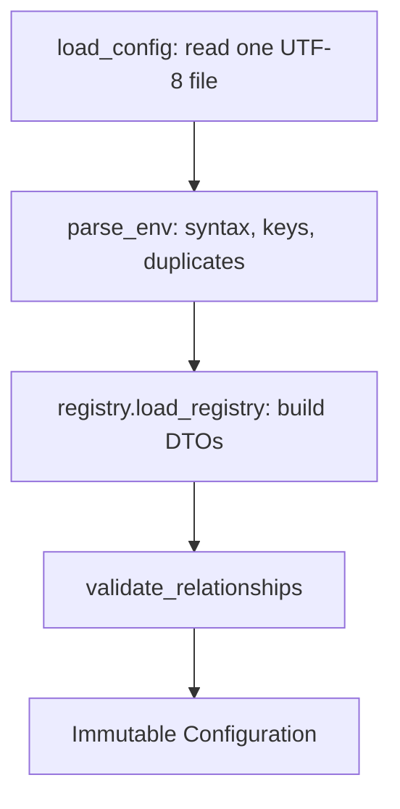

# Architecture

Scope: implemented tasks 1.1–1.2a. The application currently reads and validates configuration; it does not manage media or persistent state.

## Runtime and dependencies

[pyproject.toml](../pyproject.toml) declares Python **>=3.11**, package version `0.1.0`, and these runtime dependencies:

| Dependency | Declared range | Responsibility |
| --- | --- | --- |
| python-dotenv | `>=1.2.4,<1.3` | Parse `.env` assignments without interpolation |
| Pydantic | `>=2.12,<3` | Immutable DTOs, field types and field validation |
| Python standard library | Python >=3.11 | argparse, pathlib, zoneinfo, unittest and supporting utilities |

The repository uses a **src layout**: application packages live under `src/media_archive/`, while tests and documentation remain at the root. Setuptools maps the package root to `src` and discovers `media_archive*` packages there, disables namespace packages and excludes package data. Documentation/tests are repository resources, not runtime package data. SQLite, ExifTool, ADB and rsync are intended future components; the current configuration path does not invoke them.

```text
repository/
├── src/
│   └── media_archive/   # importable application package
├── tests/              # synthetic fixtures and unittest suites
├── docs/               # technical reference and planned designs
└── pyproject.toml      # packaging, dependencies and console entry point
```

Install with `python -m pip install -e .` before running the CLI or tests. The Python import name remains `media_archive`; `src` is a packaging directory, not part of the import name. CLI tests use isolated Python mode from a temporary working directory to exercise the installed package.

## Component map

Paths below are relative to the repository root.

| Module | Responsibility |
| --- | --- |
| [src/media_archive/__main__.py](../src/media_archive/__main__.py) | Call CLI `main()` and propagate its exit status for `python -m media_archive` |
| [src/media_archive/cli.py](../src/media_archive/cli.py) | Parse arguments, display help, invoke the configuration loader and print safe Polish diagnostics |
| [config/__init__.py](../src/media_archive/config/__init__.py) | Public configuration imports |
| [config/loader.py](../src/media_archive/config/loader.py) | Read one registry configuration file, validate the resulting configuration |
| [config/env.py](../src/media_archive/config/env.py) | Allowed keys, syntax parsing and registry-list parsing |
| [config/registry.py](../src/media_archive/config/registry.py) | Translate registry-based `.env` settings into DTOs |
| [config/builders.py](../src/media_archive/config/builders.py) | Select exact fields and translate Pydantic errors without private inputs |
| [config/base.py](../src/media_archive/config/base.py) | Shared immutable model settings and private representations |
| [config/models.py](../src/media_archive/config/models.py) | App/source/storage DTOs and aggregate `Configuration` |
| [config/collections.py](../src/media_archive/config/collections.py) | Policy/collection/backup-profile DTOs and pure collection lookups |
| [config/identities.py](../src/media_archive/config/identities.py) | Extract stable keys and reject unknown IDs against supplied registration state; no persistence |
| [config/field_types.py](../src/media_archive/config/field_types.py) | Reusable field types and validators |
| [config/validation.py](../src/media_archive/config/validation.py) | Cross-model references, collection tree, source rules and storage boundaries |
| [config/errors.py](../src/media_archive/config/errors.py) | `ConfigError`, a `ValueError` subclass with safe CLI messages |

## CLI execution

Both `python -m media_archive` and the installed `media-archive` script reach `media_archive.cli.main(argv=None)`.

| Invocation | Behavior | Process status |
| --- | --- | --- |
| No arguments | Display help; do not read configuration | 0 |
| `-h` / `--help` | argparse displays help, including when `--config` is present | 0 |
| `--check-config` | Validate `.env` in the current working directory | 0 or 2 |
| `--config FILE` | Validate exactly that file, even without `--check-config` | 0 or 2 |
| Unknown command/argument | argparse argument error; no operation is executed | 2 |

Normal help-with-no-arguments and validation branches return integers from `main()`. argparse itself raises `SystemExit` for explicit help and argument errors. Successful validation prints that device availability and identity were not checked. A `ConfigError` prints to stderr and returns 2; private values and tracebacks are not forwarded by this branch.

No IMPORT/SORT/BACKUP/AUDIT subcommands or `--dry-run` option exist yet.

## Configuration execution



`load_config()` turns the supplied path into an absolute path, reads with `utf-8-sig`, and supports a UTF-8 BOM. Read/decoding failures become a generic `ConfigError` without the selected private path.

Only the registry schema is supported. Obsolete category-based settings are rejected as unknown keys. See [configuration.md](configuration.md).

## Domain relationships

```text
PhoneProfile / CameraProfile --collection_id--> LocalCollection
LocalCollection --policy_id-----------------> BackupPolicy
LocalCollection --parent_id (optional)-------> nearest parent collection
BackupProfile --collection_ids--------------> root collections
BackupProfile --archive_group_id------------> ArchiveGroup --> ArchiveTarget[]
LocalSettings ------------------------------> LocalVolume[], staging, undated
```

The import source owns device connection details and an initialization-policy setting. A local collection owns its single local-root definition, layout, policy and archive-relative destination. A backup profile selects root collections and a disk group; children are policy overrides within those roots.

Core models do not interpret names such as `main`, `secondary`, photos, documents or video as behavior. Display labels, registry IDs, profile aliases and device identifiers have distinct purposes; see [configuration.md](configuration.md).

Source `LABEL` values are editable presentation text; `ALIAS` values remain persistent identity keys. The [identity guard](identities.md) compares a candidate configuration with supplied registered IDs. Task 1.3 must supply persisted registrations and enforce this guard at operation boundaries; loading configuration does not perform historical checks.

## Side effects and boundaries

Loading configuration reads only the selected file. It does not create a database, reports or directories; update `.env`; mutate process environment variables; resolve symlinks; scan media; contact devices; or persist registrations. Importing the package does not load `.env`.

Pydantic field validation establishes individual value types. `validate_relationships()` establishes cross-model constraints. Constructing a DTO directly does not validate the complete application graph; application consumers should normally use `load_config()`.

Collection helper methods resolve configuration scopes and policies only. They do not generate a transfer plan, find actual months, check connected targets, deduplicate files by hash, confirm deletions or establish verified copies.

`Configuration.archive_mapping()` prepares a normalized relative mapping string. No historical comparison or lock is implemented. Persisting registrations and blocking destination changes belong to the future SQLite subsystem. A mounted path or configured UUID is not proof of physical device identity; runtime verification remains future work.
